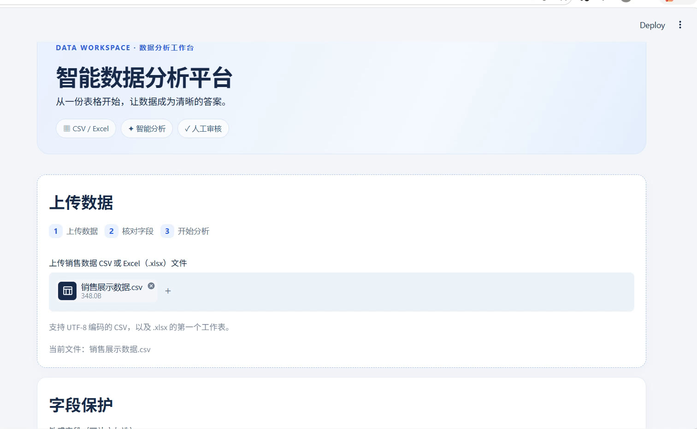
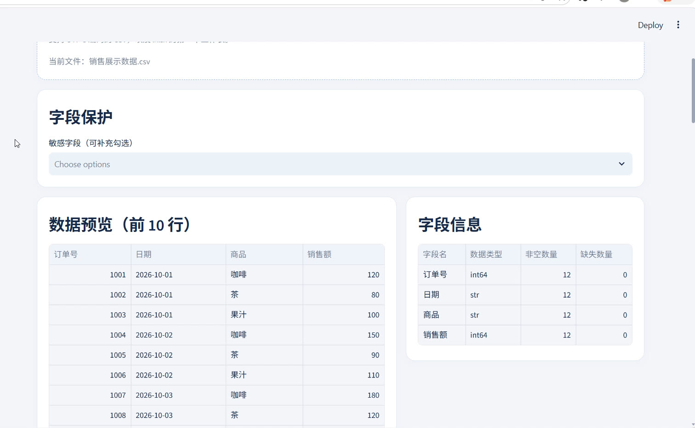
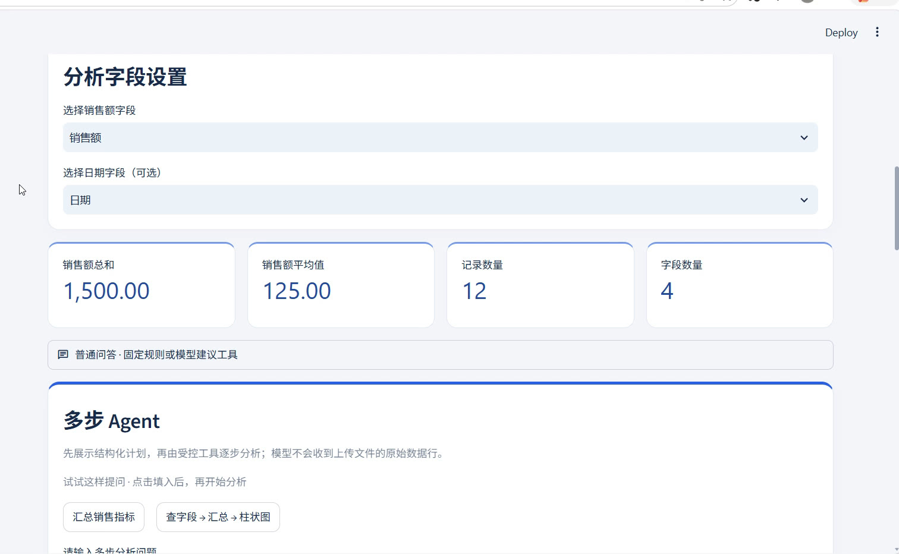
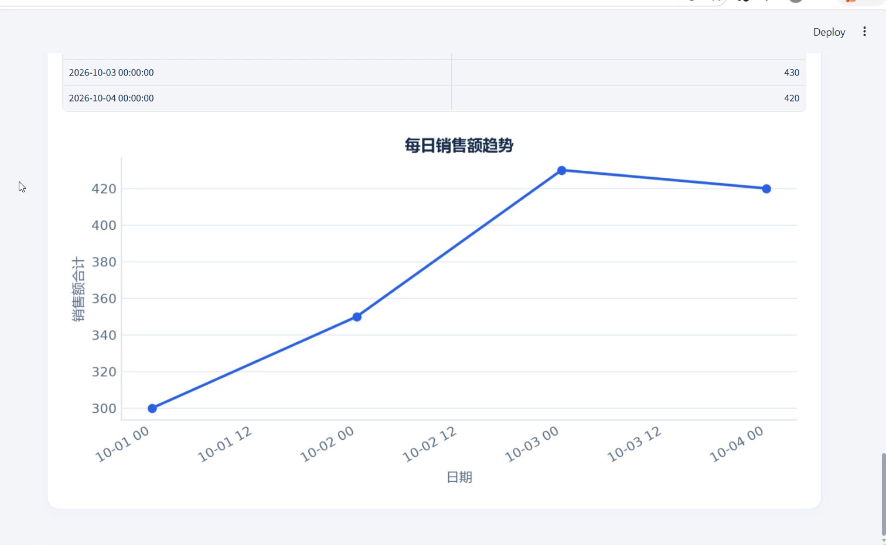

# 智能数据分析平台

基于 LangChain Agent 和通义千问的本机数据分析项目。上传销售数据后，可以查看统计结果、生成图表，并通过自然语言提出分析问题。

## 功能介绍

- **数据上传与预览**：支持 CSV 和 Excel（.xlsx），展示前 10 行数据及字段信息。
- **销售数据统计**：计算销售额总和、平均值，按商品汇总，并支持选择金额列和日期列。
- **可视化**：展示商品销售额柱状图、逐条销售额折线图和按日期汇总的趋势图。
- **智能问答与多步分析**：使用通义千问回答数据问题；Agent 可生成分析计划，并调用受控工具检查字段、计算指标和选择图表。
- **人工审核**：管理员预览敏感字段或导出全部原始数据前，系统暂停并等待批准；拒绝后终止本次分析。
- **分析过程追踪**：通过 `trace_id` 查看分析步骤、工具调用、审核结果和最终回答。
- **报告与数据导出**：下载 Markdown 分析报告；全量原始 CSV 导出需管理员审核。
- **账户与权限**：支持本机管理员和分析员登录，按账户管理分析资料。

## 页面展示

以下画面来自项目运行录屏，使用虚构销售数据。

### 数据上传



### 数据预览与字段信息



### 数据概览与多步 Agent



### 每日销售趋势



## 项目流程

1. 登录账户，上传 CSV 或 Excel 文件。
2. 选择金额列、日期列并核对敏感字段，查看数据预览和统计图表。
3. 输入分析问题，Agent 生成分析计划，再调用受控工具完成分析。
4. 涉及敏感字段预览或全量导出时，等待管理员审核。
5. 查看分析结果与 Trace，按需下载报告或已批准的原始数据。

## 项目结构

```text
├── app.py                 # 页面入口、数据展示与 Agent 交互
├── app_access.py          # 登录及账户管理页面
├── ui_theme.py            # 页面样式与展示组件
├── analysis_agent.py      # 分析计划、多步 Agent 与审核
├── sales_tools.py         # 字段检查、统计和导出等受控工具
├── risk_policy.py         # 敏感字段与风险规则
├── date_analysis.py       # 按日期汇总销售数据
├── auth_store.py          # 本机账户、登录会话与角色
├── review_store.py        # 待审核请求与检查点
├── trace_store.py         # 分析与审核记录
├── trace_viewer.py        # 分析过程展示
├── report_export.py       # Markdown 报告生成
├── run_local.py           # 本机启动入口
├── requirements.txt       # 项目依赖
├── sample_sales.csv       # 示例数据
├── demo_data/             # 演示数据
├── docs/                  # 架构、演示与项目说明
└── tests/                 # 自动化测试
```

## 技术栈

Python、LangChain、通义千问、Streamlit、Pandas、Matplotlib、SQLite。

> 本项目面向本机学习与演示。
