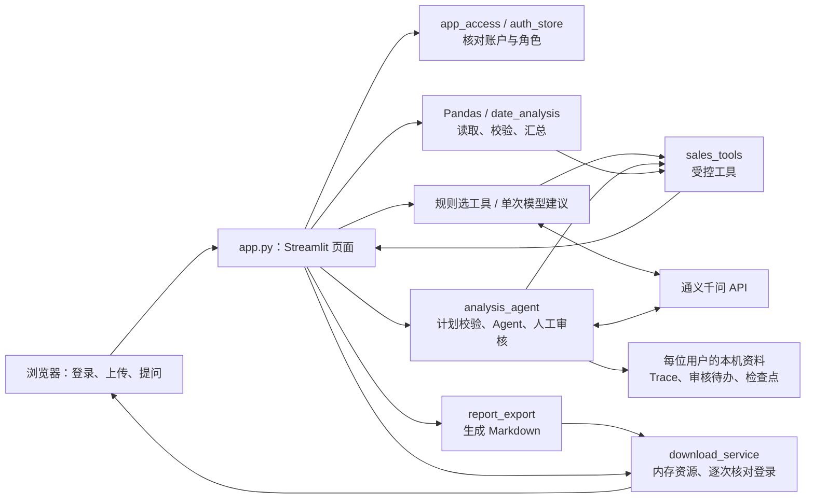
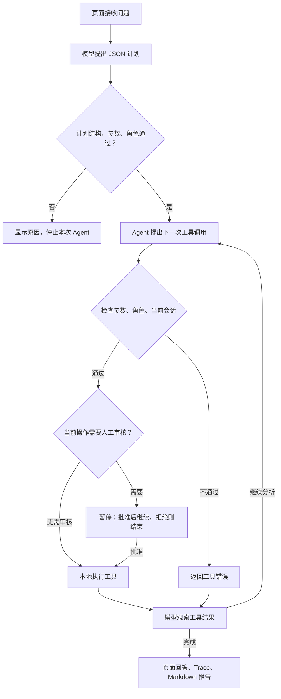

# 架构说明：从上传文件到分析结果

这是一套在本机运行的多用户销售数据分析教学项目。用户登录、上传 CSV 或 Excel，Python 读取并计算数据；需要自然语言回答时，再由通义千问组织回答。初次运行步骤见 [README](../README.md)。

阅读时先记住三个词：**工具**是已写好的 Python 函数；**Agent**是围绕模型和工具反复执行的程序；**Trace**是一次分析留下的事件记录。

## 1. 各部分如何连接

| 部分 | 在本项目里负责什么 |
| --- | --- |
| Streamlit | 展示页面、接收文件和按钮操作，保存当前页面会话状态。用户操作通常会触发脚本重新运行。 |
| Pandas | 把文件读成表格，校验金额和日期，计算总和、平均值、商品分组及每日合计。确定的数值来自这里。 |
| Matplotlib | 根据已计算的数据在页面绘图；逐条金额折线的横轴是行号，每日趋势的横轴才是日期。 |
| 通义千问模型 | 理解问题、提出计划或工具调用、根据工具结果组织文字；调用需要网络和 API Key。 |
| LangChain / LangGraph 框架 | 连接模型与工具，处理调用循环、中断及检查点。框架本身不提供销售数据。 |
| 本项目的 Agent | 把上述框架、受控工具、参数检查、角色检查和审核规则组合起来，限制模型能执行的动作。 |

## 2. 三条问答路径

页面上的本地预览、统计和绘图不要求模型连接。需要模型回答时，有三条路径：

| 入口 | 如何决定工具 | 结果如何交给模型 |
| --- | --- | --- |
| “向数据提问”，关闭建议开关 | `select_tool_calls()` 固定选择销售汇总；问题匹配一个已有商品时再查询该商品，匹配多个商品则提示拆分。 | 本地执行后发送问题和所需统计摘要，模型生成回答。 |
| “向数据提问”，开启“让模型建议工具” | 模型最多建议一个统计工具，`validate_model_tool_calls()` 校验名称、参数和调用 ID。没有建议则回到固定规则；无效建议停止本次执行。 | 用原调用 ID 对应的 `ToolMessage` 返回工具结果，再让模型回答。建议商品查询时程序仍会补充销售汇总，因此一次建议不等于只执行一个本地函数。 |
| “多步 Agent” | 先请求 JSON 计划并校验，再启动 Agent；模型每次观察工具结果后可继续调用工具。 | 工具结果和执行状态进入后续模型消息，最后输出回答；敏感预览或全量导出可能先暂停审核。 |

**计划是指导，不是强制执行清单。** 校验通过的计划会作为消息传给 Agent，代码没有逐步强制它按照计划顺序执行；每次实际工具调用仍独立校验。计划必须有 1～6 步，Agent 单次运行最多调用工具 6 次、模型 7 次；前面的规划请求另计。

## 3. 工具能做什么

工具定义集中在 [sales_tools.py](../sales_tools.py)，Agent 的创建和执行限制在 [analysis_agent.py](../analysis_agent.py)。

| 工具名 | 作用与边界 |
| --- | --- |
| `schema_inspect` | 返回记录数和非敏感字段名，不返回字段值。 |
| `sales_summary` | 返回记录数、所选金额列的总和与平均值。 |
| `product_sales_total` | 查询一个完整商品名的金额合计；商品分组依赖名为“商品”的列。缺少分组时保留接口，但调用校验不允许查询。 |
| `sales_chart` | 选择 `bar` 或 `line`，在本地保存图表类型并返回状态；图像由页面绘制。 |
| `column_preview` | 在本地准备指定列前 10 行；模型收到列名、行数和准备状态，不收到这些预览值。 |
| `full_csv_export` | 在本地准备全部上传数据的 CSV 字节；模型收到状态和行数。 |
| `daily_sales_summary` | 第七个条件工具：仅在选定日期有效、非敏感且每日汇总非空时加入，返回每日合计。 |

前六个是基础工具。工具不会接受任意 Python 代码或执行模型生成的代码；参数只允许预先定义的名称、类型和当前数据中可用的字段。

## 4. 一个请求如何完成

上传 [sample_sales.csv](../sample_sales.csv)，选择“销售额”，在多步 Agent 输入：“先检查字段，再计算销售额总和，并选择柱状图。”

一种有效计划是 `schema_inspect` → `sales_summary` → `sales_chart(bar)`。实际调用顺序由模型决定，不能把这个例子当作固定脚本。

`app.main()` 已用 Pandas 读出三行数据；销售汇总工具返回总额 `400.0`、平均值约 `133.3333`。页面金额显示为 **400.00** 和 **133.33**。图表工具记录柱状图选择，页面按商品合计绘图，模型根据返回结果生成解释。最终文字可能因模型响应而不同，核对数值应看本地统计和工具结果。

## 5. 从文件找到对应函数

| 模块 | 关键函数或类 | 阅读时关注的职责 |
| --- | --- | --- |
| [app.py](../app.py) | `main()`、`save_review_pending()`、`review_matches_pending()` | 页面主流程、三条问答路径、字段选择、审核恢复和结果展示。 |
| [app_access.py](../app_access.py) | `require_user()`、`workspace()`、`render_account_management()` | 先确认登录，再打开当前用户资料目录；管理员账户管理页面。 |
| [auth_store.py](../auth_store.py) | `authenticate()`、`resolve_session()`、`logout()` | 校验密码、查账户与会话有效性、撤销登录。 |
| [sales_tools.py](../sales_tools.py) | `select_tool_calls()`、`validate_model_tool_calls()`、`validate_agent_tool_call()`、`make_sales_summary_tool()` | 选择或校验工具，把本地数据包装成模型可调用的固定接口。 |
| [analysis_agent.py](../analysis_agent.py) | `parse_analysis_plan()`、`validate_analysis_plan()`、`tool_permitted()`、`create_analysis_agent()` | 解析计划、检查角色、创建有调用次数限制及审核中断的 Agent。 |
| [risk_policy.py](../risk_policy.py) | `evaluate_tool_risk()`、`evaluate_plan_risk()` | 统一判断敏感派生统计、角色限制、高风险审核，返回等级和原因。 |
| [date_analysis.py](../date_analysis.py) | `build_daily_sales()` | 把全部记录按自然日合计；空白或无法识别的日期会报错。 |
| [review_store.py](../review_store.py) | `save_pending()`、`load_pending()`、`take_pending()`、`matches_context()`、`open_checkpointer()` | 保存待办、核对文件与字段、一次性领取指定版本待办，读写恢复状态。 |
| [trace_store.py](../trace_store.py) | `append_trace()`、`append_audit()`、`read_trace()`、`redact()` | 记录过程与审核决定，遮挡已知敏感值，按 Trace ID 查看事件。 |
| [trace_viewer.py](../trace_viewer.py) | `build_trace_steps()`、`render_trace()` | 将历史事件整理成步骤表，查看安全摘要、风险和最终回答。 |
| [secure_storage.py](../secure_storage.py) | `workspace_for_user()`、`load_cipher()`、`encrypted_serializer()` | 用户目录隔离、读取独立存储密钥、加密保存内容。 |
| [report_export.py](../report_export.py) | `build_markdown_report()` | 组合问题、计划、统计表、图表选择说明和回答；不嵌入图像。 |
| [secure_download.py](../secure_download.py)、[download_service.py](../download_service.py) | `render_download()`、`DownloadStore.register()` / `fetch()`、`start_server()` | 生成下载按钮，短期保存资源，HTTP 请求时重新核对登录和归属。 |
| [run_local.py](../run_local.py)、[local_runtime.py](../local_runtime.py)、[backup_store.py](../backup_store.py) | `check_environment()`、`ensure_app_lock()`、`create_backup()`、`restore_backup()` | 启动检查、资料锁、停机备份与验证恢复。 |

## 6. 权限和审核是两道检查

角色回答“这个账户有没有资格做”，审核回答“这次操作是否批准”。普通统计、非敏感预览和报告下载两种角色均可使用。

| 操作 | 分析员 `analyst` | 管理员 `admin` |
| --- | --- | --- |
| 敏感字段预览 | 服务端拒绝 | 暂停审核，批准后执行 |
| 全部原始 CSV 导出 | 服务端拒绝 | 暂停审核，批准后执行 |
| 敏感商品/金额/日期的派生统计 | 禁止对应统计 | 禁止对应统计 |
| 读取另一账户的 Trace 或待办 | 不允许 | 不允许 |

审核按钮不能赋予角色权限。这里的管理员可批准自己资料的操作，没有实现另一位管理员复核的流程。分析员必须保留自动识别的敏感列；管理员可调整选择。自动识别依靠列名关键词，仍需要检查和补充。

## 7. 数据去哪儿、保存多久

| 数据 | 位置与生命周期 |
| --- | --- |
| 上传文件、DataFrame、本地图表和导出内容 | 当前进程或页面会话内存；应用不自动把原始上传文件保存到资料目录。文件或字段设置变化会清掉当前 Agent 展示状态；重启后需重新上传。 |
| 模型请求 | 点击模型功能时发送到配置的千问接口。三种问答的问题先脱敏；普通问答发送问题与摘要；Agent 规划还发送字段名，运行时发送受控工具结果及历史消息。预览工具值和完整 CSV 不作为工具结果发送。 |
| 页面登录 | 随机令牌保存在页面会话，账户库保存令牌摘要；八小时到期。页面重跑会查账户；停用、重置密码撤销该用户会话，退出撤销当前会话。 |
| Trace、审核日志、待办、检查点 | `private_data/users/<用户随机ID>/` 下持久化；退出或重启不删除。检查点保存模型消息和执行状态，待办保存审核动作及上下文。内容加密，未实现自动按天清理。 |
| 下载资源 | 本机下载服务的内存，默认 15 分钟有效，全部资源合计最多 100 MiB、最多 256 项；过期或服务重启后需重新生成。 |
| 备份 ZIP | 用户指定位置；包含账户资料和各用户的加密分析资料，副本会清除登录会话。原上传文件、临时下载、密钥和旧 `logs/` 不在备份内。 |

每次 HTTP 下载都会调用 `resolve_session()` 查账户与会话，同时核对资源所有者和原登录会话。CSV 注册时要求管理员且已批准，下载时再次检查管理员角色。令牌放在请求头，知道资源网址不足以下载；退出后旧资源即使暂留内存也无法通过会话检查。已保存到浏览器的文件不会被撤回。

**恢复待审核**需要同一账户、内容完全相同的文件、相同金额列、日期列和敏感字段，以及原存储密钥和检查点。文件以 SHA-256 摘要核对；每次审核有独立版本，批准或拒绝只消费所展示版本，旧页面不能处理下一轮待办。恢复会重新创建内存中的工具，之前只存在内存的图表选择或预览结果不会因此自动恢复。

Trace ID 用于查一次分析；线程 ID 用于定位 Agent 检查点；审核版本 ID 用于防止重复处理。这三个标识用途不同。

## 8. 演示和讲解时的实际界限

- Trace 展示问题、计划、工具名与参数、风险、受控结果摘要、状态、耗时、审核事件和脱敏最终回答；“查看 Trace”只读取记录，不展示模型内部推理，也不会自动重新执行分析。旧日志未保存的内容会明确提示。
- Markdown 报告包含文字、统计表和图表选择说明，没有嵌入图片，也不是全部原始数据副本；下载完整 CSV 是另一个需审核的功能。
- 本地统计确定，模型的计划、调用选择和解释存在变化；非法计划或调用会被拦截，超时、网络错误、调用额度不足会导致分析失败。
- 敏感金额、商品和日期不参与对应派生统计；敏感原始内容仅在管理员审核后本地预览/导出。问题在发送前脱敏，规划仍包含字段名。列名识别和文本替换不能自动辨认所有私人信息，非敏感统计也不代表经过匿名性证明。
- 加密保护的是指定资料内容，不是整个数据库文件。账户元信息、部分结构信息仍可见；拥有本机操作系统访问权及存储密钥的人仍可读取资料。存储密钥与千问 API Key 用途不同，恢复必须保留原存储密钥。
- 当前仅定位本机教学和招聘演示；页面与下载服务监听回环地址。没有公网 TLS、企业单点登录、跨机器租户隔离或自动密钥轮换，也没有任意代码执行、预测模型训练和通用数据库查询能力。

